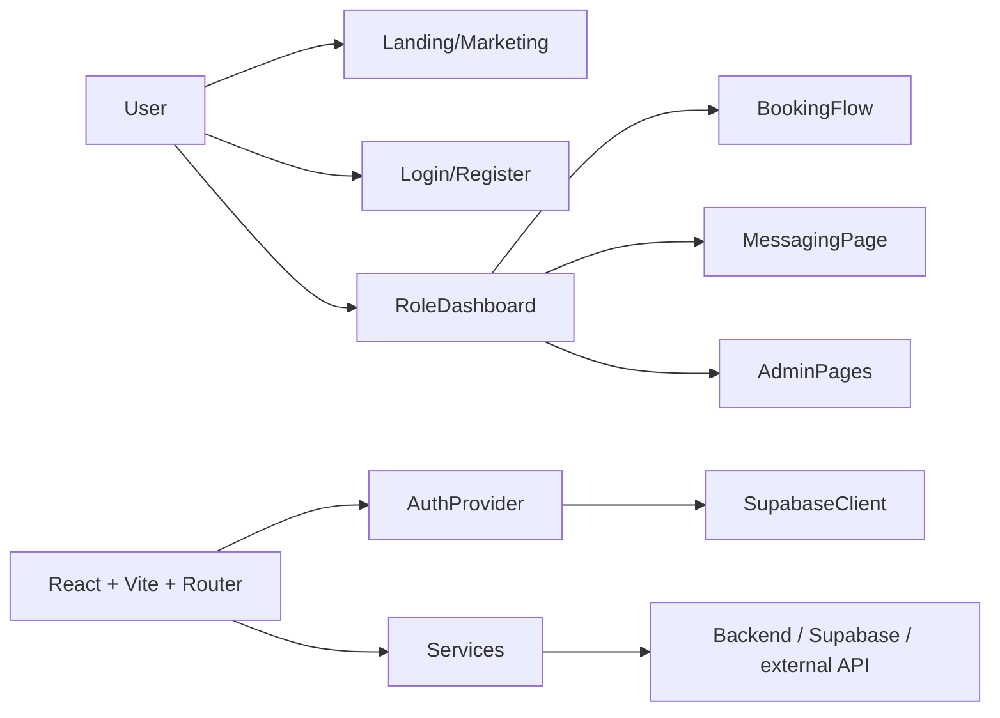

# Klastra


A role-based education and tutoring platform web app for onboarding users, managing tutor relationships, school administration, and class workflows in a modern web experience.

Created and Developed by BempsX


## Table of contents

- [About the project](#about-the-project)
- [Background and motivation](#background-and-motivation)
- [Vision, mission, purpose, and objectives](#vision-mission-purpose-and-objectives)
- [Features and capabilities](#features-and-capabilities)
- [Website pages and navigation](#website-pages-and-navigation)
- [User roles and permissions](#user-roles-and-permissions)
- [Technology stack](#technology-stack)
- [Architecture and system design](#architecture-and-system-design)
- [Project folder structure](#project-folder-structure)
- [UI/UX design system](#uiux-design-system)
- [Logo, branding, and assets](#logo-branding-and-assets)
- [Screenshots and visual documentation](#screenshots-and-visual-documentation)
- [Installation and local development](#installation-and-local-development)
- [Environment variables and configuration](#environment-variables-and-configuration)
- [Running, building, and deploying](#running-building-and-deploying)
- [Testing and quality assurance](#testing-and-quality-assurance)
- [Security and privacy](#security-and-privacy)
- [Accessibility and responsiveness](#accessibility-and-responsiveness)
- [Roadmap and known limitations](#roadmap-and-known-limitations)
- [Contributing](#contributing)
- [License](#license)
- [Frequently asked questions](#frequently-asked-questions)
- [Troubleshooting](#troubleshooting)
- [Creator and maintainer](#creator-and-maintainer)
- [Acknowledgements](#acknowledgements)

## About the project

Klastra is a Vite + React + TypeScript web application for an education and tutoring ecosystem. The repository is primarily a front-end application with public marketing pages, onboarding forms, and several role-specific dashboards for users such as students, parents, tutors, school admins, and super admins.

The application is structured like a modern multi-role SaaS product: prospective users can learn about the platform, register, complete onboarding, and then access dashboards tailored to their role. The code also contains a booking flow, messaging interface, and admin management pages that point to a broader product built around instruction, school administration, tutor verification, and lesson coordination.

This repo does not include a separate server or migration layer in the inspected files. It does contain a Supabase client dependency, which indicates that the product is intended to connect to a backend service or Supabase project for authentication and data access. That server-side implementation is not included here, so the frontend should be treated as the client layer of a larger system.

## Background and motivation

The project appears to address a real operational gap in education services: coordinating students, parents, tutors, and school administrators in a single digital experience. The structure of the code and page names suggest the app is meant to cover discovery, registration, onboarding, bookings, messaging, and administration.

The codebase includes pages such as:

- `Landing.tsx`
- `Pricing.tsx`
- `Features.tsx`
- `Register.tsx`
- `Join.tsx`
- `BookingFlow.tsx`
- `MessagingPage.tsx`
- `TutorDashboard.tsx`
- `ParentDashboard.tsx`
- `StudentDashboard.tsx`
- `SchoolAdminDashboard.tsx`
- `SuperAdminDashboard.tsx`

This indicates a practical goal: provide a single front-end experience for education stakeholders to manage learning relationships and operational workflows without relying on disconnected systems or manual coordination.

## Vision, mission, purpose, and objectives

### Vision

Create a polished digital experience for modern education and tutoring operations, with a strong emphasis on onboarding, communication, scheduling, and school oversight.

### Mission

Use a single web front-end to make it easier for users to discover tutoring services, complete registration, manage lessons, and track administrative workflows across multiple roles.

### Purpose

The application exists to provide a user-facing experience for an education platform that includes public-facing marketing, private role dashboards, and operational administration.

### General objectives

- Provide a clear public landing and conversion path.
- Support onboarding flows for new users.
- Offer dashboards for different user roles.
- Support scheduling and bookings.
- Support messaging and communication workflows.
- Include school and platform-level administrative oversight.

### Specific objectives

- Guide users from marketing and registration into a personalized experience.
- Let parents, students, and tutors access appropriate dashboards.
- Allow school administrators to manage classes and teacher relationships.
- Allow super administrators to review and manage requests.
- Use a modern frontend architecture with responsive UI and a clean design system.

### Target users

- Students
- Parents
- Tutors
- School administrators
- Super administrators
- Prospective customers exploring the platform

### Expected impact

The intended impact is to simplify the management of tutoring and educational coordination for all stakeholders while keeping the experience intuitive, role-aware, and visually consistent.

## Features and capabilities

### 1. Public-facing marketing and conversion pages

Implemented pages:

- `/`
- `/features`
- `/pricing`
- `/about`
- `/contact`
- `/support`
- `/privacy`
- `/terms`

These pages describe the product, explain the value proposition, share pricing, and provide legal/compliance information. They are implemented as React pages and wrapped in a common `Layout` shell.

### 2. Registration and onboarding flows

Routes found in the code:

- `/register`
- `/register/pending`
- `/register/documents`
- `/join`
- `/join/success`

These pages support user onboarding, forming a complete registration pathway that includes pending states and document upload tasks. This indicates a workflow for school/tutor enrollment or platform join requests.

### 3. Authentication and callback flow

The application includes:

- `/login`
- `/auth/callback`
- `/super-admin/login`

`main.tsx` wraps the app in `AuthProvider`, and `src/contexts/AuthContext.tsx` is responsible for loading the profile and tracking auth state. The project includes a Supabase client integration, which strongly suggests a secure backend identity layer is expected to exist outside this repository.

### 4. Tutor, student, and parent dashboards

The code includes:

- `StudentDashboard.tsx`
- `ParentDashboard.tsx`
- `TutorDashboard.tsx`

These pages are role-specific and likely correspond to distinct user journeys around bookings, lessons, communication, and profile management.

### 5. School administration and super-admin functionality

Implemented routes:

- `/school-admin`
- `/school-admin/classes`
- `/school-admin/classes/:id`
- `/school-admin/teachers`
- `/school-admin/teachers/invite`
- `/super-admin`
- `/super-admin/requests/:id`

These pages indicate that the platform supports operational oversight, verification of user accounts or requests, class management, and teacher onboarding/invitation flows.

### 6. Booking and messaging workflows

The app includes:

- `BookingFlow.tsx`
- `MessagingPage.tsx`

These pages suggest a full teaching/tutoring workflow that includes scheduling and communication between users.

### 7. Tutor onboarding and verification support

There is a `TutorOnboarding.tsx` page and account verification logic in the UI. The `Layout.tsx` file references tutor verification banners and onboarding prompts, indicating the product supports a verification process for tutor accounts.

### 8. Analytics and monitoring

An `Analytics.tsx` page exists in `src/pages`, indicating some reporting or analytics UI is planned or partially implemented. This repo does not reveal the exact data sources or backend calculations.

### 9. App branding and visual identity

The app includes branding assets and a strong visual style with a dark Navy palette, glassmorphism layers, and gradient-inspired ambiance. This is implemented in `src/index.css` and the design utilities used in the layout.

## Website pages and navigation

The following routes are present in `src/App.tsx`.

| Route | Page | Purpose | Access requirements | Status |
| --- | --- | --- | --- | --- |
| `/` | Landing | Product landing page | Public | Implemented |
| `/features` | Features | Product features overview | Public | Implemented |
| `/pricing` | Pricing | Pricing and plans | Public | Implemented |
| `/contact` | Contact | Contact page | Public | Implemented |
| `/about` | About | Product/company overview | Public | Implemented |
| `/privacy` | Privacy | Privacy policy | Public | Implemented |
| `/terms` | Terms | Terms of use | Public | Implemented |
| `/support` | Support | Support/help information | Public | Implemented |
| `/login` | Login | User login | Public | Implemented |
| `/auth/callback` | AuthCallback | OAuth/auth redirect callback | Public | Implemented |
| `/register` | Register | Registration | Public | Implemented |
| `/register/pending` | RegisterPending | Registration pending state | Public | Implemented |
| `/register/documents` | RegisterDocuments | Document submission | Public | Implemented |
| `/join` | Join | Join flow | Public | Implemented |
| `/join/success` | JoinSuccess | Join confirmation | Public | Implemented |
| `/school-admin` | SchoolAdminDashboard | School admin overview | Role-based / likely authenticated | Implemented |
| `/school-admin/classes` | SchoolAdminClasses | Class administration | Role-based / likely authenticated | Implemented |
| `/school-admin/classes/:id` | SchoolAdminClassDetail | Class detail | Role-based / likely authenticated | Implemented |
| `/school-admin/teachers` | SchoolAdminTeachers | Teachers listing | Role-based / likely authenticated | Implemented |
| `/school-admin/teachers/invite` | SchoolAdminInviteTeacher | Invite teacher | Role-based / likely authenticated | Implemented |
| `/super-admin/login` | SuperAdminLogin | Super admin login | Public | Implemented |
| `/super-admin` | SuperAdminDashboard | Platform administration | Role-based / likely authenticated | Implemented |
| `/super-admin/requests/:id` | SuperAdminRequestDetail | Request detail | Role-based / likely authenticated | Implemented |
| `*` | NotFound | 404 fallback | Public | Implemented |

Additional implemented pages in `src/pages` which are not directly connected in the main router but are clearly part of the application include:

- `Analytics.tsx`
- `BookingFlow.tsx`
- `MessagingPage.tsx`
- `TutorOnboarding.tsx`
- `StudentDashboard.tsx`
- `ParentDashboard.tsx`
- `TutorDashboard.tsx`

## User roles and permissions

The application clearly supports multiple roles. The user-facing behavior and file organization suggest the following roles:

| Role | Observed evidence | Typical purpose |
| --- | --- | --- |
| Student | `StudentDashboard.tsx`, `Layout.tsx` role definitions | Book lessons and access personal learning workspace |
| Parent | `ParentDashboard.tsx` | Monitor child progress and coordinate learning |
| Tutor | `TutorDashboard.tsx`, tutor verification banner | Manage bookings, availability and profile verification |
| School admin | `SchoolAdminDashboard.tsx` and related pages | Manage classes, teachers, and school operations |
| Super admin | `SuperAdminDashboard.tsx`, `SuperAdminLogin.tsx` | Manage platform-level operations |
| Guest/public | `Landing.tsx`, `Login.tsx`, `Register.tsx` | Learn about the product and register |

The UI contains role-specific nav and access flow logic, but the repo does not include a separate backend RBAC implementation in the files inspected. For security-sensitive access control, role enforcement should be verified on the server side rather than trusting front-end route hiding or button visibility alone.

## Technology stack

### Frontend and app shell

- React 19
- TypeScript 5.7
- Vite 8
- React Router DOM 7
- @tanstack/react-query 5

### Styling and design

- Tailwind CSS 4
- @tailwindcss/vite
- Custom CSS variables and theme tokens in `src/index.css`
- Google Fonts: Plus Jakarta Sans and Inter

### Authentication and data layer

- @supabase/supabase-js 2.x

This dependency indicates that Supabase is used or intended to be used for auth, data access, or state management. This repo does not include the server-side Supabase configuration or schema files in the inspected files.

### Build and validation

- TypeScript compiler (`tsc`)
- Vite build pipeline
- `npm run lint` uses `tsc --noEmit`

### Deployment

- `vercel.json` exists and rewrites SPA routes to `index.html`, which indicates Vercel deployment is intended.

## Architecture and system design

This repository is a frontend-only application built around a single-page application architecture.



### Frontend architecture

- `src/main.tsx` boots the app and wraps it in `QueryClientProvider` and `AuthProvider`.
- `src/App.tsx` defines page routes and navigation structure.
- `src/components/Layout.tsx` creates the main shell used by many pages.
- `src/pages/*` contains the individual UI screens.
- `src/index.css` defines theme variables, glass effects, gradients, and custom design utilities.

### Data flow

- React Query provides caching and state management for async data.
- `AuthContext` loads the current profile and authenticates the user.
- Routes are organized by role and public/private state.

### Supabase and backend integration

This repo contains a Supabase client dependency and auth-related logic, but not the actual server-side schema or secure config. In practice, the backend should manage:

- authentication
- access control / RBAC
- database queries
- profile data and documents
- lesson and booking storage

## Project folder structure

```text
.
├── public/
│   ├── favicon.png
│   └── logo-mark.png
├── src/
│   ├── App.tsx
│   ├── components/
│   │   ├── AccessibleDialog.tsx
│   │   ├── AppDownloadModal.tsx
│   │   ├── DownloadAppButton.tsx
│   │   ├── Layout.tsx
│   │   └── ui.tsx
│   ├── config/
│   ├── contexts/
│   │   └── AuthContext.tsx
│   ├── data/
│   ├── hooks/
│   ├── imports/
│   │   ├── adaptive-icon.png
│   │   ├── favicon.png
│   │   ├── hero-classroom.png
│   │   ├── hero-student.png
│   │   ├── icon.png
│   │   ├── logo-mark.png
│   │   ├── logo.png
│   │   ├── splash-waves.png
│   │   └── splash.png
│   ├── lib/
│   ├── pages/
│   │   ├── About.tsx
│   │   ├── Analytics.tsx
│   │   ├── AuthCallback.tsx
│   │   ├── AuthForm.tsx
│   │   ├── BookingFlow.tsx
│   │   ├── Contact.tsx
│   │   ├── Features.tsx
│   │   ├── HealthCheck.tsx
│   │   ├── Join.tsx
│   │   ├── JoinSuccess.tsx
│   │   ├── Landing.tsx
│   │   ├── Login.tsx
│   │   ├── MessagingPage.tsx
│   │   ├── ParentDashboard.tsx
│   │   ├── Pricing.tsx
│   │   ├── Privacy.tsx
│   │   ├── Register.tsx
│   │   ├── RegisterDocuments.tsx
│   │   ├── RegisterPending.tsx
│   │   ├── SchoolAdminClassDetail.tsx
│   │   ├── SchoolAdminClasses.tsx
│   │   ├── SchoolAdminDashboard.tsx
│   │   ├── SchoolAdminInviteTeacher.tsx
│   │   ├── SchoolAdminTeachers.tsx
│   │   ├── StudentDashboard.tsx
│   │   ├── SuperAdminDashboard.tsx
│   │   ├── SuperAdminLogin.tsx
│   │   ├── SuperAdminRequestDetail.tsx
│   │   ├── Support.tsx
│   │   ├── Terms.tsx
│   │   ├── TutorDashboard.tsx
│   │   ├── TutorOnboarding.tsx
│   │   └── ...
│   ├── services/
│   ├── index.css
│   ├── main.tsx
│   └── vite-env.d.ts
├── .gitattributes
├── .gitignore
├── .mise.toml
├── index.html
├── package.json
├── package-lock.json
├── tsconfig.json
├── vercel.json
├── vite.config.ts
└── README.md
```

## UI/UX design system

### Visual direction

The design system is modern and education-focused, with a calm, trust-building palette. The project uses a strong navy base and blue/teal accent system.

### Theme values observed in `src/index.css`

| Token | Value |
| --- | --- |
| Base background | `#F8FAFC` |
| Primary nav / dark surface | `#0F172A` |
| Dark navy | `#102A43` |
| Blue accent | `#2563EB` |
| Teal accent | `#0F9D8A` |
| Typography | `Plus Jakarta Sans` and `Inter` |

### Layout patterns

- Dashboard-like card system using `.stat-card`, `.tutor-card`, `.card-shadow`, and `.card-shadow-md`
- Soft glassmorphism surfaces with `glass-light`, `glass-medium`, `glass-heavy`, and `glass-dark`
- Mesh-like background effects and orb gradients for hero sections
- Responsive sidebar and mobile navigation patterns in `Layout.tsx`

### Interaction patterns

- Soft hover elevation and transitions
- Focus-visible outline styling for accessibility
- Responsive top navigation and mobile bottom nav
- Custom progress bar and message bubble styles

### Accessibility notes

The code includes `:focus-visible` styling and semantic focus ring behavior, but the app does not appear to contain an automated accessibility audit in the repo. Major interactive flows should be checked through keyboard navigation and screen-reader validation.

## Logo, branding, and assets

### Primary logo assets

The repository contains these branding assets:

- `public/logo-mark.png`
- `public/favicon.png`
- `src/imports/logo.png`
- `src/imports/logo-mark.png`
- `src/imports/favicon.png`

The logo used in the app is the mark version, imported in `src/components/Layout.tsx`:

```tsx
import logoMark from '../imports/logo-mark.png';
```

### Visual assets

The project also includes hero imagery and splash assets in `src/imports`:

- `hero-classroom.png`
- `hero-student.png`
- `splash.png`
- `splash-waves.png`
- `adaptive-icon.png`
- `icon.png`

These assets support the product’s educational branding and landing page content.

## Screenshots and visual documentation

There are no screenshot files committed in the repository at the moment. The project does include several design-heavy assets in `src/imports` and a strong marketing UI in the route pages, but no final screenshot gallery has been added yet.

Recommended screenshot checklist for future documentation:

- Landing page hero / headline
- Feature overview section
- Registration flow
- Tutor dashboard
- Parent dashboard
- School admin dashboard
- Super admin request detail
- Booking flow
- Messaging experience

Example placeholder section using an existing asset when available:

```md

```

This is a placeholder-safe example using an existing repository asset until a real app capture is added.

## Installation and local development

### Prerequisites

- Node.js 18+ recommended
- npm

### Install dependencies

```bash
npm install
```

### Run in development mode

```bash
npm run dev
```

The app is configured to serve on:

- host: `0.0.0.0`
- port: `5173`

### Type checking

```bash
npm run lint
```

This command runs:

```bash
tsc --noEmit
```

### Production build

```bash
npm run build
```

### Preview production build locally

```bash
npm run preview
```

The preview server is configured for:

- host: `0.0.0.0`
- port: `4173`

## Environment variables and configuration

This repository does not include an `.env.example` file or a documented set of environment names in the inspected files. However, the code includes `@supabase/supabase-js`, which strongly suggests project configuration is likely required for live backend access.

A typical Vite-safe setup would look like this:

```env
VITE_SUPABASE_URL=your_supabase_url
VITE_SUPABASE_ANON_KEY=your_anon_key
```

Important notes:

- Do not add any service-role keys or privileged credentials to client-side environment files.
- Validate the actual environment variable names against the project's real backend config before deployment.
- If the app uses a separate backend repository or external service, those values should be managed there and passed to the front end only as needed.

## Running, building, and deploying

### Development mode

```bash
npm run dev
```

### Production build

```bash
npm run build
```

### Deployment model

The repo includes a `vercel.json` file:

```json
{
  "rewrites": [
    {
      "source": "/((?!api/|assets/|.*\\..*).*)",
      "destination": "/index.html"
    }
  ]
}
```

This indicates the app is designed for a Vercel-style SPA deployment with client-side routing support.

### Example deployment notes

#### Vercel deployment example

```bash
npm install
npm run build
```

Then import the repository into Vercel and use the default Vite settings.

Expected Vercel behavior:

- build command: `npm run build`
- output directory: `dist`
- SPA rewrite support: handled by `vercel.json`

#### Production environment checklist

- Confirm public environment variables such as `VITE_SUPABASE_URL` and `VITE_SUPABASE_ANON_KEY`.
- Ensure the backend/auth provider is up and reachable.
- Confirm all client-side routes are rewritten correctly for SPA behavior.
- Verify any API calls from the front end have valid permitted origins and auth policies.

### Deployment notes

- The front-end is a SPA, so a rewrite rule is important for route fallback.
- Any backend or API integration must be configured separately from this repository.
- The actual production environment should be confirmed externally to avoid exposing private credentials.

## Testing and quality assurance

### Verified state

The repo contains no explicit automated test suite files such as Vitest, Jest, Playwright, or Cypress configuration in the inspected files.

### Verified commands

The project supports:

```bash
npm run lint
npm run build
```

### Recommended future QA

- Unit tests for auth state and route guards
- Component tests for booking and dashboard flows
- E2E validation of registration, login, and school admin flows
- Manual smoke test for responsive layouts and role navigation

## Security and privacy

### Observed security posture

- The app uses `AuthProvider` to load the current profile and auth state.
- It depends on Supabase for auth-related connectivity.
- The code contains role-based UI experiences.

### Important caveat

The front-end alone cannot guarantee authorization or data security. Access checks must also be enforced in a backend or database layer. Hiding a button or route in the UI is not a substitute for real authorization.

### Privacy and config considerations

- Do not store private credentials in source files.
- Do not expose service-role keys in README or client code.
- Keep `.env` values out of version control (`.gitignore` includes `.env*` patterns).
- Validate file upload and user-submitted content on a server before persisting it.

## Accessibility and responsiveness

### Responsive design

The app includes mobile navigation, responsive layout patterns, and desktop dashboard layouts. The layout is designed to adapt depending on screen size and uses a responsive top bar and sidebar model.

### Accessibility signals

- `:focus-visible` styling is defined in `src/index.css`.
- Buttons and links use visible focus ring states.
- The design uses contrast-friendly backgrounds and text colors with navy and blue tones.

### Accessibility follow-up

This repository does not contain a formal accessibility audit or screen-reader checklist. It is recommended to test:

- keyboard navigation
- form labels and validation feedback
- dialog focus behavior
- screen-reader compatibility for admin dashboards and forms

## Roadmap and known limitations

### Implemented and visible

- Public marketing website
- Registration and onboarding pages
- Tutor/student/parent dashboards
- School admin and super-admin pages
- Booking and messaging workflows
- Vite-based frontend architecture
- Tailwind-based styling system

### Known limitations and unverified items

- No backend schema or migration files are present in this repo.
- No explicit full test suite was located.
- No `.env.example` exists in the inspected files.
- The canonical product naming may need clarification because `package.json` is named `tutorkonnect-web` while the repo is `klastra-web`.
- Supabase integration details are not fully documented in the repo.
- No OSI license file was found in the root.

## Contributing

Contributions are welcome if the project is intended to grow as an open source or collaborative frontend. The recommended flow is:

1. Fork the repository.
2. Clone it locally.
3. Create a new branch.
4. Run `npm install`.
5. Make your changes.
6. Run `npm run lint` and `npm run build`.
7. Commit using clear messages.
8. Open a pull request.

Example:

```bash
git clone https://github.com/kwakubempah863-cell/klastra-web.git
cd klastra-web
npm install
npm run dev
```

## License

No license file was identified in the repository root during the inspection. As a result, the repository’s licensing status is not specified in the current project files.

## Frequently asked questions

### How do I run the project locally?

```bash
npm install
npm run dev
```

### What is the app for?

It is a web front-end for an education and tutoring platform with onboarding, messaging, booking, dashboards, and administration.

### Where is the backend?

This repository appears to be the frontend only. Supabase is used as a client dependency, but the server or schema files are not present in the inspected project files.

### Is this deployed on Vercel?

The repo contains `vercel.json`, which strongly suggests Vercel deployment is intended.

### Are there tests?

Not in the files inspected. Type checking and build validation are available via `npm run lint` and `npm run build`.

## Troubleshooting

### Issue: app does not load data or auth state

**Probable cause:** missing backend configuration or inaccessible environment values.

**Fix:** confirm the Supabase configuration and make sure the required client values are correctly configured in the environment.

### Issue: build fails

**Probable cause:** TypeScript errors or dependency mismatch.

**Fix:** run:

```bash
npm run lint
npm run build
```

### Issue: routes show blank or 404-like behavior in production

**Probable cause:** missing SPA rewrite configuration.

**Fix:** verify `vercel.json` is present and correctly configured.

### Issue: login/auth flow does not complete

**Probable cause:** frontend auth flow without a working backend or Supabase project.

**Fix:** confirm the backend and Supabase project are connected and configured correctly.

## Creator and maintainer

Created and Developed by BempsX

This repository is the work of BempsX, and the branding and implementation files included here reflect that origin.

## Acknowledgements

This project uses:

- React
- TypeScript
- Vite
- Tailwind CSS
- React Router
- React Query
- Supabase JavaScript client

These technologies provide the base foundation for the project and are referenced in the manifest and source code.

## Final project summary

Klastra is a modern education-focused web platform built with React, TypeScript, and Vite. It includes public-facing marketing, onboarding, dashboards for multiple roles, booking and messaging features, and school/admin management interfaces. The project is clearly positioned as a role-based platform for education stakeholders, and the branding assets and design system are strongly defined in the frontend implementation.

The app is in a functioning frontend state with clear architecture and partial product flows, but the backend integration, auth enforcement, environment configuration, and schema are not fully present in this repository and should be confirmed externally.

---

This README was generated from the actual repository files inspected in the project, including `package.json`, `src/App.tsx`, `src/main.tsx`, `src/index.css`, `src/components/Layout.tsx`, `src/contexts/AuthContext.tsx`, and the `public`/`src/imports` asset directories.
